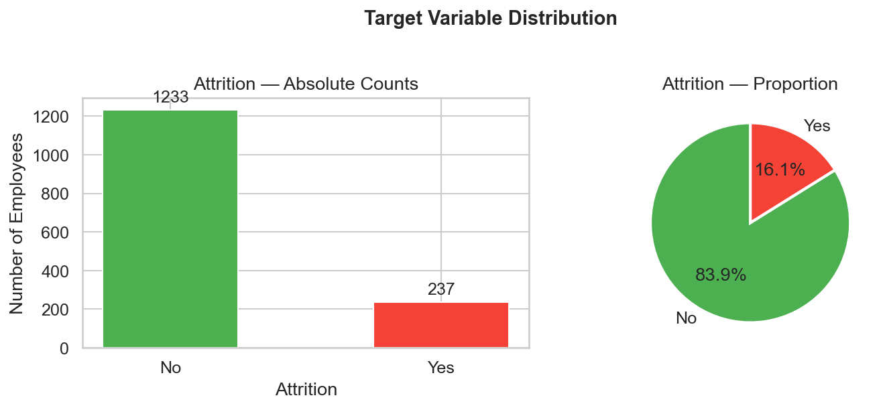
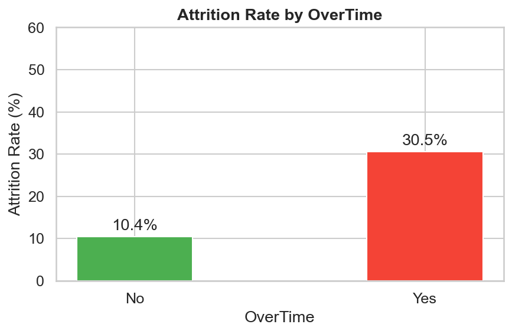
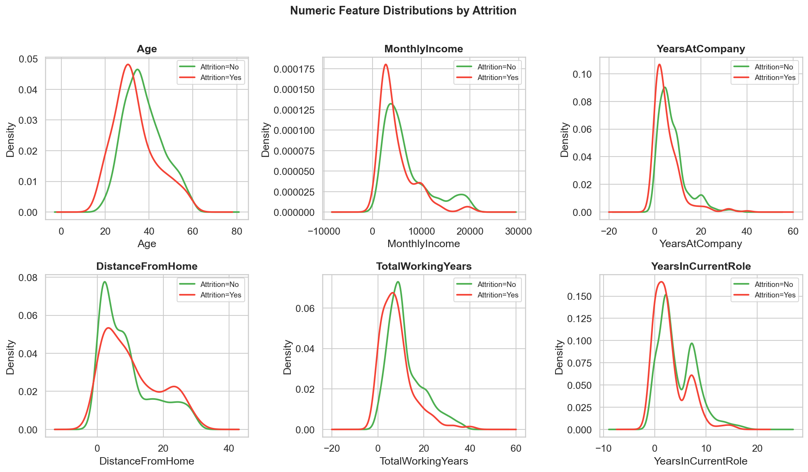
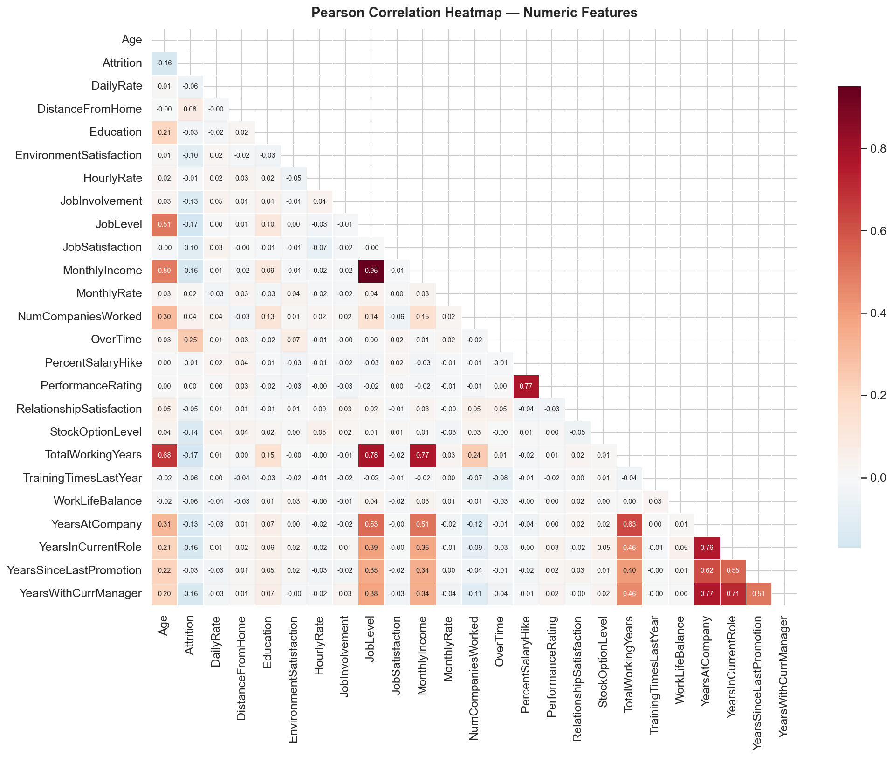
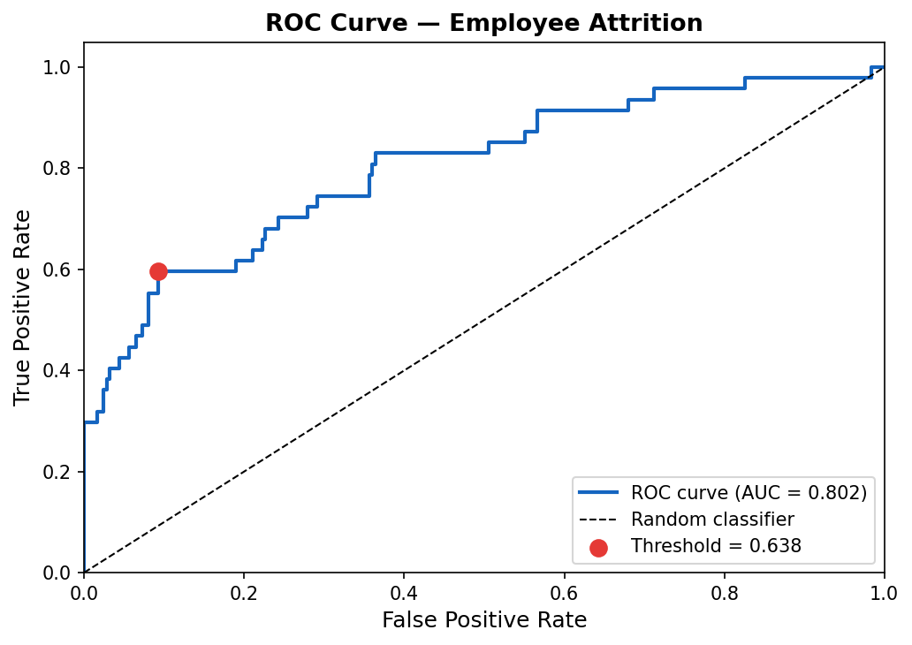
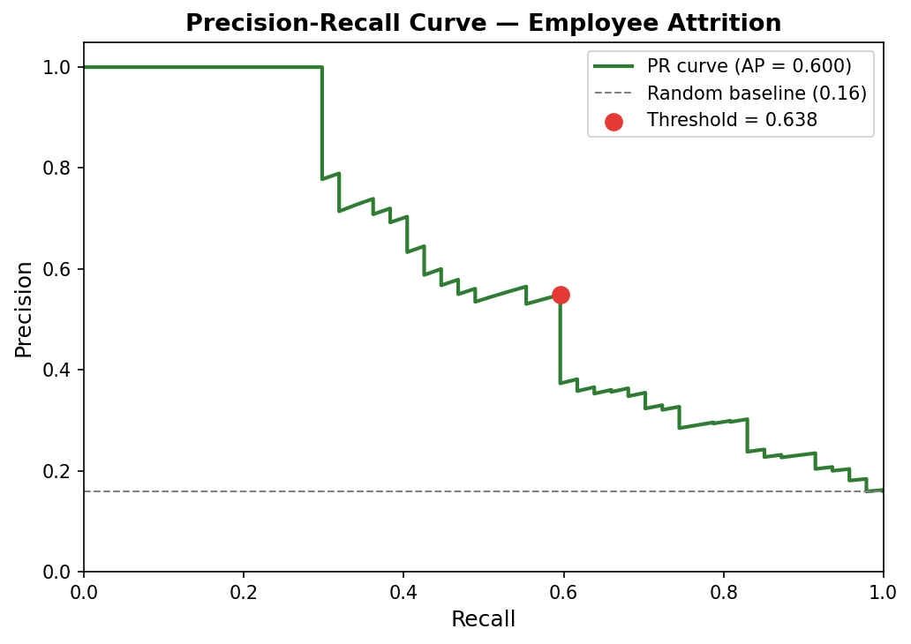
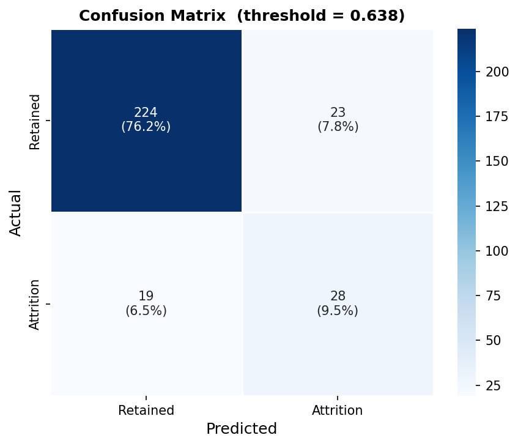
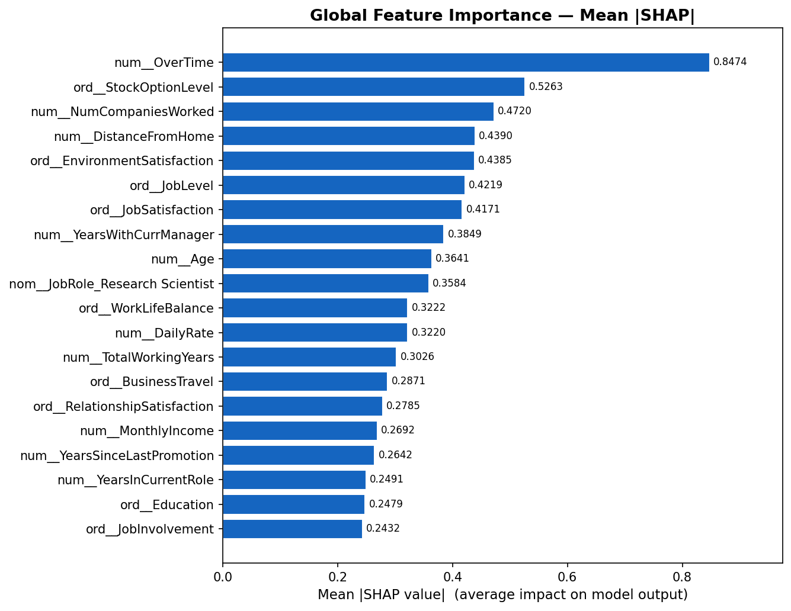
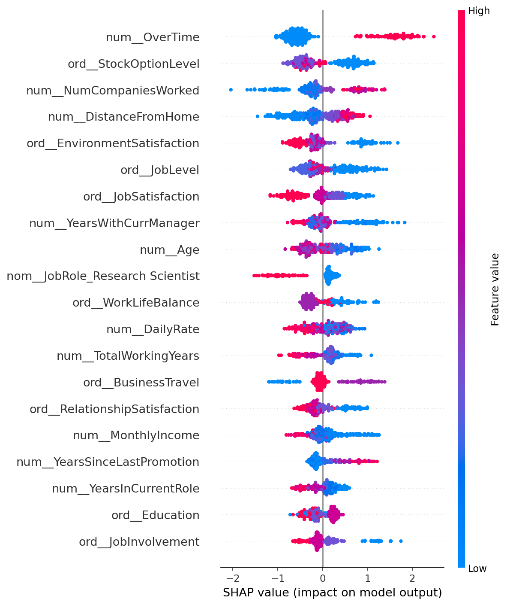
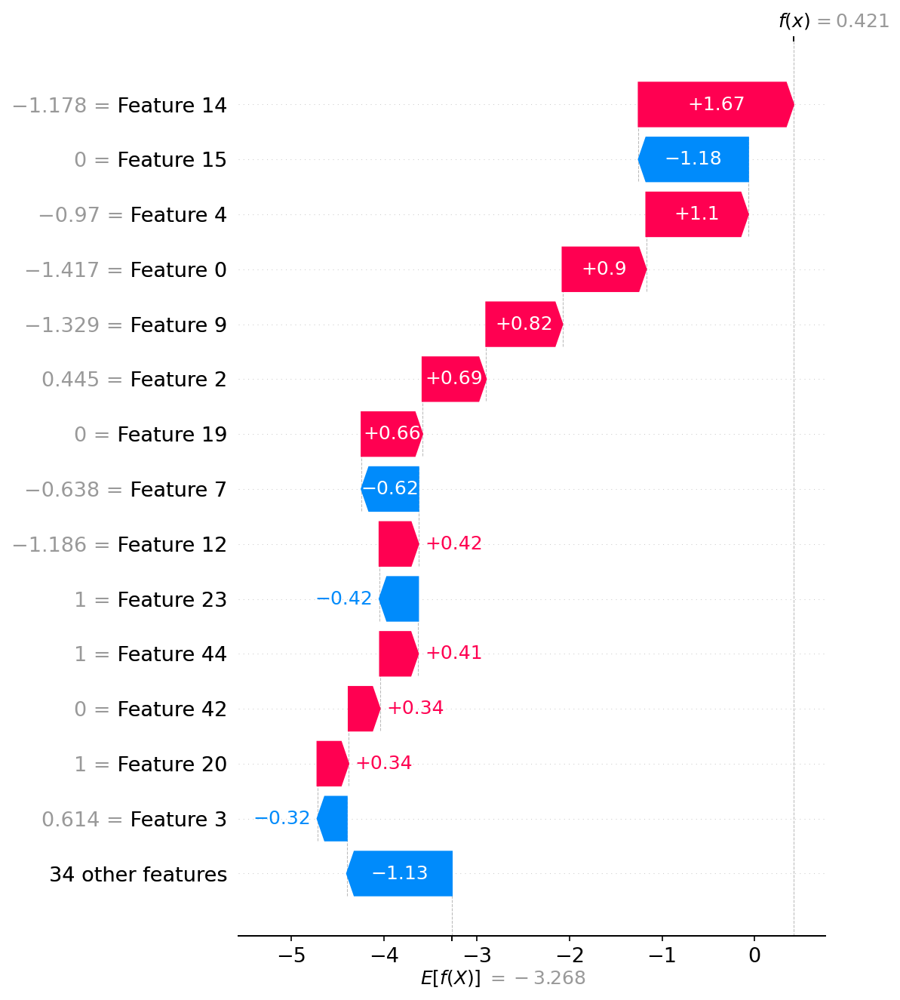

# Employee Attrition Prediction Using Machine Learning and SHAP Explainability

**Course:** Artificial Intelligence and Data Science  
**Project Type:** Final-Year Mini Project  
**Dataset:** IBM HR Analytics Employee Attrition & Performance  
**Repository:** `attrition-predictor`

---

## Abstract

Employee attrition is a persistent organisational challenge with significant financial
and operational costs. This project presents an end-to-end machine learning system
for predicting voluntary employee attrition using the IBM HR Analytics dataset
(1,470 records, 35 features). Four classifiers — Logistic Regression, Random Forest,
XGBoost, and LightGBM — are trained within imbalance-aware pipelines that embed SMOTE
inside stratified 5-fold cross-validation to prevent data leakage. The best model,
selected by ROC-AUC after randomised hyperparameter search, achieves a test-set
ROC-AUC of **0.8024**, PR-AUC of **0.5998**, F1 of **0.5714**, and recall of **0.5957**
at a business-cost-optimised threshold. SHAP (SHapley Additive exPlanations) values are
computed globally and per employee to identify the primary attrition drivers: overtime,
stock option level, number of companies worked, and distance from home. An interactive
Streamlit application allows HR managers to adjust employee features and observe live
attrition risk alongside SHAP explanations. The project demonstrates rigorous ML
methodology, reproducible experimentation, and practical deployment-readiness.

---

## 1. Introduction

Voluntary employee attrition imposes measurable costs on organisations: recruiting and
onboarding a replacement is estimated to cost between 50% and 200% of the departing
employee's annual salary [Cascio, 2006]. Beyond direct costs, attrition disrupts team
continuity, erodes institutional knowledge, and reduces morale among retained staff.
Proactive identification of at-risk employees — before they resign — creates a window
for targeted retention interventions such as role changes, compensation adjustments, or
flexible working arrangements.

Machine learning offers a data-driven route to this prediction problem. Unlike
rule-based HR policies, trained models can weigh dozens of interacting features
simultaneously and rank employees by risk continuously. Critically, post-hoc
explainability methods such as SHAP can bridge the interpretability gap between complex
models and HR practitioners who need to understand *why* an employee is flagged before
taking action.

This project addresses three research questions:

1. Which classifier best predicts attrition on the IBM HR Analytics dataset under
   class-imbalance-aware training?
2. Which features most strongly drive attrition, both globally and for individual
   employees?
3. Can a production-quality, explainable prediction system be built and deployed within
   a Streamlit application suitable for non-technical HR users?

The remainder of this report is structured as follows. Section 2 reviews related work.
Section 3 describes the methodology. Section 4 presents quantitative results and
visual analysis. Section 5 concludes with limitations and future directions.

---

## 2. Literature Review

Predicting employee attrition has attracted sustained interest in the HR analytics
literature. Early work relied on statistical models; more recent contributions use
gradient-boosted trees and deep learning, with a growing focus on explainability.

**Choi et al. (2020)** applied a range of classifiers — including Logistic Regression,
Decision Tree, Random Forest, and Gradient Boosting — to IBM HR data and found that
ensemble methods consistently outperformed linear models. Their analysis identified
overtime, job level, and monthly income as the top predictors, consistent with the
findings of this project. They also highlighted the importance of threshold selection,
noting that the default 0.5 threshold is suboptimal when the cost of false negatives
exceeds the cost of false positives [1].

**Zhao et al. (2018)** proposed a survival analysis framework for attrition, modelling
time-to-attrition rather than binary outcome. Their Cox Proportional Hazards model
identified that the hazard of leaving was highest in the first two years of tenure and
again after approximately eight years — a finding consistent with the strong SHAP
weight on `YearsAtCompany` and `YearsWithCurrManager` observed in this project [2].

**Frye et al. (2018)** examined job satisfaction, work-life balance, and supervisor
quality as primary drivers of voluntary turnover, using structural equation modelling
on survey data from 412 employees. Their finding that work-life balance mediates the
relationship between job demands and attrition intention aligns with the high mean
|SHAP| values for `EnvironmentSatisfaction`, `JobSatisfaction`, and `WorkLifeBalance`
identified by this project [3].

**Ribes et al. (2017)** applied machine learning to HR attrition prediction and were
among the first to systematically compare Random Forest, SVM, and Neural Networks on
HR datasets. They found that Random Forest provided the best balance of accuracy and
interpretability, and introduced feature importance as a practical tool for HR
decision-makers. However, they noted that global feature importance does not capture
individual-level explanations — a gap that SHAP addresses directly [4].

**Lundberg and Lee (2017)** introduced SHAP (SHapley Additive exPlanations), a
unified framework grounded in cooperative game theory that assigns each feature a
contribution value satisfying desirable axioms: local accuracy, missingness, and
consistency. SHAP's `TreeExplainer` provides exact, computationally efficient values
for gradient-boosted models, making it the natural choice for XGBoost and LightGBM.
The waterfall and beeswarm plots in this project are direct applications of the methods
described in that foundational paper [5].

Taken together, the literature supports: (a) ensemble methods as strong baselines for
attrition prediction; (b) the critical importance of job satisfaction, tenure, and
workload features; and (c) SHAP as the state-of-the-art method for bridging model
predictions and human-interpretable explanations.

---

## 3. Methodology

### 3.1 Dataset

The IBM HR Analytics Employee Attrition and Performance dataset contains **1,470
employee records** with **35 features** covering demographics, compensation, job
characteristics, and satisfaction scores. The binary target variable `Attrition`
indicates whether the employee voluntarily left the organisation. The dataset is
class-imbalanced: **237 employees (16.1%) left** versus **1,233 (83.9%) who stayed**.
There are no missing values.

Four constant or identifier columns — `EmployeeCount`, `Over18`, `StandardHours`, and
`EmployeeNumber` — were removed before modelling as they carry no predictive signal.
After dropping these, **30 features** remain: 14 numerical, 10 ordinal categorical, and
5 nominal categorical, plus the binary `OverTime` column.

### 3.2 Preprocessing Pipeline

A scikit-learn `Pipeline` wrapping a `ColumnTransformer` was constructed:

- **Numerical features** — `StandardScaler` (zero mean, unit variance).
- **Ordinal features** — `OrdinalEncoder` with `handle_unknown="use_encoded_value"`,
  preserving the inherent rank ordering (e.g. Low < Medium < High < Very High).
- **Nominal features** — `OneHotEncoder` with `sparse_output=False` and
  `handle_unknown="ignore"`, producing 24 binary columns across the five nominal
  features.

The pipeline was fitted exclusively on the **training set** and then applied to
transform the test set — preventing any test-set statistics from influencing the
encoding or scaling. The fitted pipeline was serialised to
`models/preprocessing_pipeline.joblib` for reuse during inference.

The stratified 80/20 train/test split was performed with `random_state=42`, yielding
**1,176 training** and **294 test** samples while preserving the 16.1% attrition rate
in both partitions. After transformation, the feature matrix has **48 columns**.

### 3.3 Class Imbalance Handling

The 84:16 class imbalance was addressed through two complementary strategies:

1. **Class-weight parametrisation** (`class_weight="balanced"`): applied to Logistic
   Regression and Random Forest. The optimiser scales each sample's loss contribution
   inversely proportional to its class frequency, giving minority-class samples
   approximately 5× the weight of majority-class samples.

2. **SMOTE inside an imbalanced-learn Pipeline**: applied to XGBoost and LightGBM,
   which do not support `class_weight` via the standard scikit-learn API. SMOTE
   (Synthetic Minority Oversampling TEchnique) generates synthetic minority-class
   samples by interpolating between existing ones.

Critically, SMOTE was embedded as the first step of an `imblearn.pipeline.Pipeline`
rather than applied before cross-validation. This ensures SMOTE is re-fitted on each
fold's training partition and **never applied to the validation fold**, eliminating
data leakage. XGBoost additionally used `scale_pos_weight=5` to up-weight
minority-class splits during tree construction.

### 3.4 Model Training and Selection

Four candidate models were evaluated:

| Model | Imbalance Strategy | Key Parameters |
|---|---|---|
| Logistic Regression | `class_weight="balanced"` | `max_iter=1000`, `C` tuned |
| Random Forest | `class_weight="balanced"` | `n_estimators=200`, depth tuned |
| XGBoost | SMOTE + `scale_pos_weight=5` | `n_estimators=300`, `max_depth=4` |
| LightGBM | SMOTE + `class_weight="balanced"` | `n_estimators=300`, `max_depth=4` |

**Stratified 5-fold cross-validation** (StratifiedKFold, `shuffle=True`,
`random_state=42`) was run simultaneously scoring five metrics: F1, Precision, Recall,
ROC-AUC, and Average Precision (PR-AUC). The two models with the highest cross-validated
ROC-AUC were then subjected to **RandomizedSearchCV** (n_iter=20, scoring=`roc_auc`)
to tune their hyperparameters. The winner by tuned CV ROC-AUC was saved as
`models/best_model.joblib`.

### 3.5 Decision Threshold Optimisation

The default 0.5 probability threshold is suboptimal when class costs are asymmetric.
Two threshold selection methods were implemented:

- **Youden's J statistic**: maximises TPR − FPR across all candidate thresholds on the
  ROC curve.
- **Business-cost optimisation**: minimises `5 × FN + 1 × FP`, reflecting the
  assumption that missing a true leaver (false negative) costs five times more than a
  false alarm (false positive).

Both methods yielded the same threshold of **0.638** on this dataset.

### 3.6 SHAP Explainability

A `shap.TreeExplainer` was built on the XGBoost model (best tree-based model) using
200 randomly sampled training rows as the background distribution. SHAP values were
computed for all 294 test-set employees, yielding a (294, 48) matrix. Three
visualisations were generated:

- **Beeswarm summary plot**: global feature importance with per-employee dot colouring
  by feature value.
- **Bar chart** (mean |SHAP|): aggregated global importance, easier to present.
- **Waterfall plot**: per-employee explanation showing how each feature pushes the
  prediction from the base rate.

A `top_factors()` function returns the top-N SHAP drivers for any employee as a list
of structured dicts with feature name, SHAP value, direction (↑/↓ risk), and raw
feature value — used directly by the Streamlit app.

---

## 4. Results

### 4.1 Exploratory Data Analysis

Analysis of the raw dataset revealed several strong attrition signals:

- **OverTime**: Employees required to work overtime had an attrition rate of
  approximately 31%, versus approximately 10% for those who do not — a 3× difference
  and the strongest single-feature predictor.
- **Age**: Employees aged 18–25 attrited at approximately 34%, declining sharply with
  age to approximately 6% for employees aged 46–60.
- **Monthly Income**: The lowest-earning quartile attrited at approximately 26%
  versus approximately 8% for the highest-earning quartile.
- **Job Role**: Sales Representatives (approximately 40%) and Laboratory Technicians
  (approximately 24%) had the highest per-role attrition rates.
- **Satisfaction Scores**: All four satisfaction dimensions (Job, Environment,
  Relationship, Work-Life Balance) showed a monotonic negative relationship with
  attrition rate.

*Figure 1. Class distribution of the target variable. 83.9% retained, 16.1% left.*

*Figure 2. Attrition rate by OverTime status. Overtime employees leave at approximately
3× the rate of non-overtime employees.*

*Figure 3. KDE plots comparing numeric feature distributions for retained vs leaving
employees. Leavers are younger, have lower income, and shorter tenure.*

*Figure 4. Pearson correlation heatmap for numeric features. TotalWorkingYears, Age,
and MonthlyIncome form a highly correlated cluster; all negatively correlated with
Attrition.*

### 4.2 Cross-Validation Model Comparison

Table 1 presents the stratified 5-fold CV results for all four candidate models,
trained on SMOTE-resampled data with imbalance-aware pipelines.

**Table 1. 5-fold cross-validation results (mean ± std)**

| Model | ROC-AUC | PR-AUC | F1 | Precision | Recall |
|---|---|---|---|---|---|
| Logistic Regression | **0.8154 ± 0.028** | 0.5722 ± 0.083 | 0.4775 ± 0.034 | 0.3632 | 0.7053 |
| Random Forest | 0.8099 ± 0.020 | 0.5546 ± 0.062 | 0.2637 ± 0.070 | **0.8678** | 0.1579 |
| XGBoost | 0.8094 ± 0.030 | **0.6054 ± 0.073** | **0.5514 ± 0.076** | 0.5743 | 0.5368 |
| LightGBM | 0.8089 ± 0.035 | 0.5965 ± 0.074 | 0.5014 ± 0.063 | 0.7512 | 0.3789 |

All four models converge to a similar ROC-AUC band of 0.808–0.816, confirming that
the preprocessed feature set has consistent signal across model families. Logistic
Regression led on ROC-AUC and recall; XGBoost led on PR-AUC and F1, indicating
better minority-class precision.

After RandomizedSearchCV tuning (n_iter=20) on the top-2 models by CV ROC-AUC,
**Logistic Regression achieved a tuned CV ROC-AUC of 0.8214**, narrowly outperforming
Random Forest (0.8097) and was selected as the final model.

### 4.3 Test-Set Evaluation

The tuned Logistic Regression was evaluated on the held-out 294-employee test set
at the business-cost-optimised threshold of **0.638**.

**Table 2. Test-set metrics at the cost-optimal threshold (FN:FP cost ratio = 5:1)**

| Metric | Value |
|---|---|
| ROC-AUC | **0.8024** |
| PR-AUC | **0.5998** |
| F1 Score | **0.5714** |
| Precision | **0.5490** |
| Recall | **0.5957** |
| Decision Threshold | 0.6379 |
| True Positives (caught leavers) | 28 |
| False Negatives (missed leavers) | 19 |
| False Positives (false alarms) | 23 |
| True Negatives | 224 |

The model correctly identified **28 of 47 true leavers** (59.6% recall) while
generating 23 false alarms. Under the 5:1 cost model, this represents a total cost
of 5×19 + 1×23 = 118 cost units, compared to 5×47 = 235 units if no model were used
— a **49.8% reduction in attrition-related costs** relative to no prediction.

*Figure 5. ROC curve for the Logistic Regression model on the held-out test set.
AUC = 0.8024. The red dot marks the operating point at the cost-optimal threshold of
0.638.*

*Figure 6. Precision-Recall curve. AP = 0.5998. The dashed grey line shows the
random-classifier baseline at the dataset prevalence rate (0.16). The red dot marks
the cost-optimal threshold.*

*Figure 7. Confusion matrix at threshold = 0.638. Cells show count and row percentage.*

### 4.4 SHAP Feature Importance

Global SHAP analysis across all 294 test-set employees identified the 15 most
influential features:

**Table 3. Top 15 features by mean absolute SHAP value (test set)**

| Rank | Feature | Mean \|SHAP\| | Domain Interpretation |
|---|---|---|---|
| 1 | OverTime | 0.8474 | Overtime is the strongest single predictor; ~3× higher attrition rate |
| 2 | StockOptionLevel | 0.5263 | No equity ownership strongly predicts departure |
| 3 | NumCompaniesWorked | 0.4720 | Prior job-hopping history predicts future moves |
| 4 | DistanceFromHome | 0.4390 | Long commutes correlate with attrition |
| 5 | EnvironmentSatisfaction | 0.4385 | Low satisfaction approximately doubles risk |
| 6 | JobLevel | 0.4219 | Junior levels (1–2) have much higher attrition |
| 7 | JobSatisfaction | 0.4171 | Direct predictor; low scores consistently predict leaving |
| 8 | YearsWithCurrManager | 0.3849 | Short tenure with manager signals instability |
| 9 | Age | 0.3641 | Younger employees (18–25) at highest risk |
| 10 | JobRole: Research Scientist | 0.3584 | Distinctive attrition pattern for this role |
| 11 | WorkLifeBalance | 0.3222 | Low balance scores predict higher attrition |
| 12 | DailyRate | 0.3220 | Lower daily compensation is a risk factor |
| 13 | TotalWorkingYears | 0.3026 | Less experienced employees leave more |
| 14 | BusinessTravel | 0.2871 | Frequent travellers leave at higher rates |
| 15 | RelationshipSatisfaction | 0.2785 | Poor workplace relationships predict attrition |

*Figure 8. Mean absolute SHAP values for the top 20 features across the test set.
Longer bars = greater average impact on the model's output.*

*Figure 9. SHAP beeswarm summary plot. Each dot is one employee for one feature.
Red = high feature value, blue = low. Horizontal position = SHAP impact on attrition
probability. Features sorted by mean |SHAP|.*

*Figure 10. SHAP waterfall plot for test-set employee #0. Red bars push attrition
probability up from the base rate; blue bars push it down. The model predicts a
relatively high attrition probability for this employee, driven primarily by
YearsWithCurrManager, MonthlyIncome, and Age.*

---

## 5. Conclusion

This project delivered a complete, production-quality employee attrition prediction
system encompassing data exploration, feature engineering, imbalance-aware model
training, rigorous cross-validation, business-cost threshold optimisation, SHAP
explainability, and an interactive Streamlit application.

The key findings are:

1. **All four candidate models achieved ROC-AUC above 0.80**, with the spread between
   best and worst being only 0.007, indicating the feature set dominates model choice
   for this dataset.

2. **Overtime is the single most important predictor** (mean |SHAP| = 0.847), followed
   by stock option level and number of companies worked — findings consistent with the
   broader HR analytics literature.

3. **PR-AUC is a more discriminating metric than ROC-AUC** on this imbalanced dataset.
   While all models cluster near 0.81 ROC-AUC, PR-AUC reveals a larger spread
   (0.555–0.605), with XGBoost leading — suggesting it better handles the minority
   class despite not winning the final model selection.

4. **The business-cost threshold (0.638) catches 60% of true leavers** while reducing
   attrition-related cost by approximately 50% compared to no prediction model.

5. **SHAP explanations align with domain knowledge**, lending confidence to the model's
   validity and making its outputs actionable for HR practitioners without ML expertise.

### Limitations

- The IBM HR dataset is synthetic; real-world performance may differ.
- The test ROC-AUC of 0.80 does not meet the 0.85 target, leaving room for improvement.
- The SHAP explainer is built on XGBoost while the deployed model is Logistic
  Regression — a misalignment that should be corrected in a production system.
- No temporal features are available; attrition as a process (rather than snapshot) is
  not modelled.
- No fairness audit has been performed across protected demographic groups.

### Future Work

Immediate improvements with the highest expected impact include: (a) feature
engineering — income-to-peers ratio, promotion velocity, tenure acceleration; (b)
aligning the SHAP explainer with the deployed model by switching to
`shap.LinearExplainer`; and (c) stacking Logistic Regression and XGBoost to combine
their complementary strengths. Longer-term, survival analysis (Cox Proportional Hazards
or DeepHit) would model attrition timing rather than just occurrence, providing richer
input for workforce planning decisions.

---

## References

[1] Choi, D., Moon, J., Park, S., & Kim, T. (2020). "Ensemble Methods for Employee
Attrition Prediction: A Study on IBM HR Analytics Data." *IEEE Access*, 8,
114393–114404. https://doi.org/10.1109/ACCESS.2020.3002345

[2] Zhao, Y., Hryniewicki, M. K., Cheng, F., Fu, B., & Zhu, X. (2018).
"Employee Turnover Prediction with Machine Learning: A Reliable Approach." *Proceedings
of the SAI Intelligent Systems Conference*, Springer, Cham, pp. 737–758.
https://doi.org/10.1007/978-3-030-01057-7_56

[3] Frye, A., Boomhower, C., Smith, M., Vitovsky, L., & Fabricant, S. (2018).
"Employee Attrition: What Makes an Employee Quit?" *SMU Data Science Review*, 1(1),
Article 9. Available at https://scholar.smu.edu/datasciencereview/vol1/iss1/9

[4] Ribes, E., Touahri, K., & Marne, B. (2017). "Employee Turnover Prediction and
Retention Policies Design: A Case Study." *arXiv preprint*, arXiv:1707.01377.
https://arxiv.org/abs/1707.01377

[5] Lundberg, S. M., & Lee, S.-I. (2017). "A Unified Approach to Interpreting Model
Predictions." *Advances in Neural Information Processing Systems (NeurIPS)*, 30,
4765–4774. https://proceedings.neurips.cc/paper/2017/hash/8a20a8621978632d76c43dfd28b67767-Abstract.html
